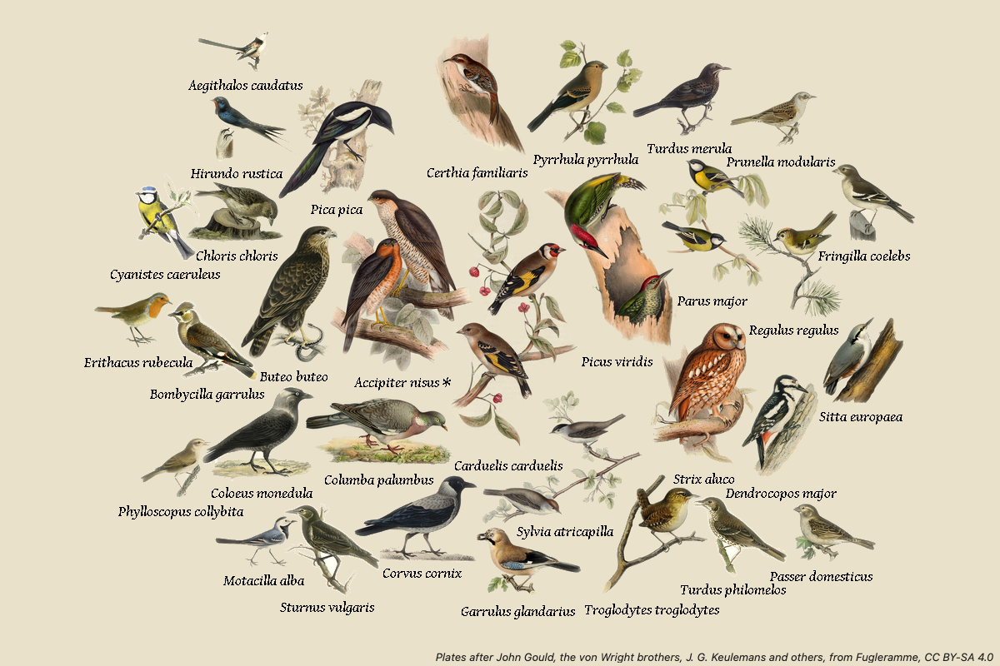

# Fugleramme

A [Tesserae](https://github.com/dmellok/tesserae) widget: the birds your BirdNET-Go or a BirdWeather station heard, as hand-coloured 1800s plates packed onto one printed page.

> **This is [Fugleramme](https://github.com/arnegiacomo/fugleramme), by Arne Giacomo Munthe-Kaas, ported to Tesserae with his permission.**
> The page is drawn by Fugleramme's own renderer, vendored at release v0.29.0, and the plates are Fugleramme's: some 1200 cut-outs of over 650 species from Gould, the von Wright brothers, Audubon and many more, hand-curated, none AI-generated, under CC BY-SA 4.0. If you like the page, go and see the project it comes from: [github.com/arnegiacomo/fugleramme](https://github.com/arnegiacomo/fugleramme), with its [docs](https://arnegiacomo.dev/fugleramme/) and a [live frame](https://fugleramme.arnegiacomo.dev). This widget is maintained separately from Fugleramme, so report problems with it here, not there.



## The pages

| Page | What it shows |
| --- | --- |
| **Collage** | Every bird heard in the window (15 minutes to all time), each sized by its real body mass, packed by its silhouette so nothing overlaps and nothing clips. Names under the birds, or a numbered key beside or below them. |
| **Latest bird** | The bird calling now, large, with its name and the time its run of calls began. |
| **Newest arrival** | The latest species heard for the first time ever, with the date. |

The collage packs in one of Fugleramme's two layouts: **Spiral** grows out from the middle (a round cluster with bare corners) and **Voids** puts each bird on the emptiest paper it fits, filling the corners. **Spotlight** draws the latest bird large in the middle with the rest round it. **How many birds** limits the page, and **Which birds** picks them: the most heard, the rarest in the window, the rarest all time, or the latest heard. A bird first heard in the last 24 hours gets Fugleramme's newcomer mark after its name.

Each bird wears one of its plates a day, picked from its name and the date, so a bird that stays all week still changes.

## Setting it up

Pick a **Detector**:

- **BirdNET-Go**: type the address its web page opens at, such as `http://birdnet.local:8080`. A password is only needed when its Private Mode keeps the detections behind a login.
- **BirdWeather station**: a public station's number, or its page such as `https://app.birdweather.com/stations/123`. Up to five, separated by commas, are read as one.

Leave the address or the station empty and the widget shows a **demo garden** (thirty-odd birds of a northern European garden, one of them new today), so every page and layout can be tried first.

The rest of the options, all as Fugleramme offers them:

| Option | Choices |
| --- | --- |
| Page | Collage, Latest bird, Newest arrival |
| Window (collage) | Last 15 minutes up to Last 30 days, or All time |
| Layout, Spotlight, How many birds, Which birds (collage) | as above |
| Names | on or off |
| Numbered key (collage) | numbers on the birds, the names in a key |
| Names in, Second line | Scientific, the detector's own language, English, or any of BirdNET's 36 other label languages (see below) |
| Typeface | Gentium Book Plus, EB Garamond, Cormorant Garamond, Libre Baskerville, Playfair Display, Alegreya, Bitter |
| Name size | Small, Medium, Large, Extra large |
| Margin | 0 to 25% of the short side, bare paper for a mat |
| Paper | Flat (Fugleramme's e-ink page, the default) or Textured (its screen page) |

### Names in other languages

Names come from where Fugleramme takes them. From a BirdNET-Go: its dictionary for the language you pick, or, with **The detector's own language**, its species list in whatever language BirdNET-Go is set to (BirdNET-Go's own locale). From a BirdWeather station: BirdWeather's names in that language. A **Second line** in another language stacks under the first, in parentheses. Dates on the Latest bird and Newest arrival pages are written in the page's language (`October 23, 6:56 AM`, `10月23日 7:56`).

BirdNET's own label list in the same language, fetched from [BirdNET-Analyzer v2.4.0](https://github.com/birdnet-team/BirdNET-Analyzer/tree/v2.4.0/birdnet_analyzer/labels/V2.4) on first use and kept, names the demo garden and fills in a bird the detector has no name for. That is the one place the widget goes beyond Fugleramme, which shows the scientific name there.

Chinese, Japanese, Korean, Thai, Arabic, Hebrew and Malayalam names are set in Fugleramme's Noto faces, fetched from Fugleramme the first time a page needs one. A name no face here can set shows as its scientific name, as in Fugleramme. Arabic, Hebrew and Malayalam also need Pillow's text shaping (raqm, which needs the system's `libfribidi`); without it those names show as scientific names.

**Paper** matters on a panel. Tesserae quantises every page to the panel's own colours after it is drawn, and Fugleramme's textured paper has a grain that a six-colour panel turns into speckle, so the default is the flat page Fugleramme draws for its own e-ink panel: an even paper tone and solid black names.

## How it works

`fetch()` asks the detector what Fugleramme's page would ask it, records the answers, and works out which plates and faces the page needs. The job it records is keyed on Fugleramme's own state key: everything the page is a function of (the birds, the names, the layout, the day, the settings). `client.js` then loads the page as a PNG from the widget's own route, `/plugins/fugleramme/page.png?job=…&w=…&h=…`, at the cell's real pixel size, and waits for it to decode before the panel's screenshot is taken. The route replays the recorded answers into Fugleramme's renderer, which draws exactly the page Fugleramme would at that size, and keeps the PNG. A page is drawn once per job and size: until the birds change, every render is a file read.

The plates (about 220 MB in all) and the faces (about 5 MB) are not in the widget. Each is fetched from Fugleramme's repository at the pinned commit the first time a page needs it, from `raw.githubusercontent.com/arnegiacomo/fugleramme/03046c7…/assets/…`, and kept in the widget's data folder; only the small records ship (which plates exist, where the bird is on each, who made it). The first page of a new garden takes a few seconds while its plates arrive. If a plate cannot be fetched, its bird is left off the page and tried again within the hour; if a face cannot be fetched, the names are set in a serif the machine already has.

The widget asks for `network:*` because the BirdNET-Go address is whatever you type. Beyond your detector it only talks to `app.birdweather.com` (for a BirdWeather station) and `raw.githubusercontent.com` (Fugleramme's plates and faces, and BirdNET's label lists).

## Credits and licence

- **Fugleramme**, by Arne Giacomo Munthe-Kaas: the renderer, the sources, the layouts and the page design. MIT. [github.com/arnegiacomo/fugleramme](https://github.com/arnegiacomo/fugleramme).
- **The plates**: Fugleramme's classic style, hand-coloured plates from Gould, the von Wright brothers, Audubon, Dresser, Fuertes, Keulemans and others, cut and edited for Fugleramme, offered under [CC BY-SA 4.0](https://creativecommons.org/licenses/by-sa/4.0/). Each plate's source is in [`assets/artwork/classic/manifest.json`](assets/artwork/classic/manifest.json), and every work's terms in [`assets/artwork/classic/ATTRIBUTION.md`](assets/artwork/classic/ATTRIBUTION.md). The credit line under the page, always shown, names the artists of the plates on it; on a narrow cell it shortens to "Plates from Fugleramme, CC BY-SA 4.0".
- **The faces**: SIL Open Font License 1.1, fetched from Fugleramme.
- **Body masses**: AVONET (Tobias et al. 2022), CC BY 4.0. **Name aliases**: OpenFauna, CC BY-SA 4.0. **Labels**: BirdNET v2.4.

The widget's code is MIT, with Fugleramme's copyright kept on the vendored files; see [`LICENSE`](LICENSE) and [`ATTRIBUTION.md`](ATTRIBUTION.md).

## Development

```sh
pip install pytest pytest-xdist jsonschema flask pillow numpy
python -m pytest -n auto tests
```

The tests never touch the network: plates are stood in for, and the detector is patched. With a Tesserae checkout beside this repository, the manifest is also validated against its schema.
